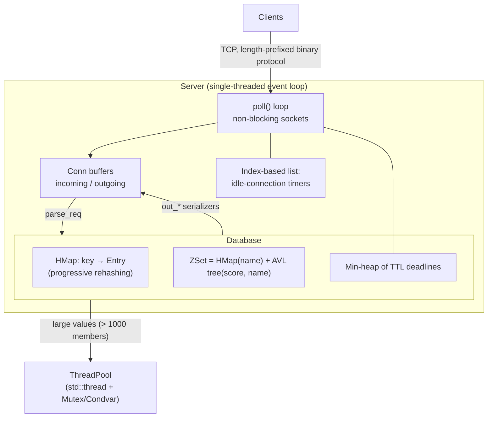

# redis-rust

An in-memory, Redis-like key-value server written in **Rust**: a single-threaded
`poll()` event loop, hand-built data structures (progressive-rehash hashtable, AVL
tree, min-heap), sorted sets, key TTLs, idle-connection timeouts and a thread pool
for freeing large values off the hot path.

This is a complete Rust migration of the original C++23 project (itself a port of
the book *Build Your Own Redis with C/C++*). All C++ sources and build tooling have
been removed.

## Build (one line)

```bash
cargo build --release
```

Requirements: Linux (POSIX sockets + `poll(2)`), a recent stable Rust toolchain, and
Python 3 for the end-to-end test. There are no third-party crates.

```bash
./target/release/redis_server --port 1234 &
./target/release/redis_cli set greeting hello     # (nil)
./target/release/redis_cli get greeting           # (str) hello
```

## Commands

| Command | Description |
|---|---|
| `get key` / `set key value` / `del key` | String values (binary-safe) |
| `keys` | List all keys |
| `pexpire key ms` / `pttl key` | Set / read a TTL in milliseconds (`-1` no TTL, `-2` no key) |
| `zadd zset score name` | Add or update a sorted-set member |
| `zrem zset name` / `zscore zset name` | Remove / read a member |
| `zquery zset score name offset limit` | Range query from `(score, name)`, O(log n) offset |

## Architecture



| Module | Responsibility |
|---|---|
| `src/server.rs` | Event loop, connection state machine, pipelining, idle timers, graceful shutdown |
| `src/protocol.rs` | Request parsing, tagged (TLV) response encoding/decoding |
| `src/database.rs` | Key space, command handlers, TTL heap, async deletion |
| `src/hashtable.rs` | Chained hashtable with incremental (bounded-work) rehashing |
| `src/avl.rs`, `src/zset.rs` | AVL tree with subtree counts (rank queries); sorted set |
| `src/heap.rs`, `src/list.rs` | Timer data structures |
| `src/thread_pool.rs` | Producer/consumer pool (mutex + condition variable) |
| `src/bin/` | `redis_server`, `redis_cli`, `redis_bench`, `bench_hashtable` |

Design notes:

- **The main thread never does unbounded work**: rehashing moves ≤128 keys per
  operation, expiry deletes ≤2000 keys per loop iteration, and big sorted sets are
  freed on the pool.
- **Arena indices instead of intrusive pointers**: safe Rust cannot store
  `container_of`-style back-pointers in arbitrary payloads, so each container keeps
  nodes in a stable `Vec<Option<T>>` arena and links them by index. A `ZNode` is
  still in a hashtable *and* an AVL tree at once, with one allocation.
- **Idle timers need no heap**: all connections share one timeout, so a FIFO list is
  already sorted by deadline (O(1) refresh).
- **Heap back-references** use `Arc<AtomicUsize>` so entries remain `Send` and can
  be moved to the thread pool.

## Testing

- Unit/integration tests for every data structure, the protocol and the command
  layer, including randomized differential tests against `std::collections`
  containers, exhaustive AVL/heap positions, and a random-input robustness test for
  both parsers.
- Integration tests start a real `Server` on an ephemeral port: pipelining (2000
  requests in one write), 8 MiB values, malformed requests, idle timeouts,
  background expiry.
- End-to-end test runs the real binaries against the book's command transcript.
- Deterministic TTL tests use an injected clock (no sleeps).

```bash
cargo test
cargo test --release
cargo clippy --all-targets -- -D warnings
cargo fmt --check
python3 tests/e2e/test_cmds.py \
  --server target/release/redis_server \
  --cli target/release/redis_cli
```

## Benchmarks

**Hashtable resize latency** — `cargo run --release --bin bench_hashtable -- 5000000`

The interesting column is **max**: `std::collections::HashMap` rehashes every key at
once when it grows, while `HMap` spreads that work across later operations.

**Server throughput** — `./target/release/redis_server --quiet &` then:

```bash
./target/release/redis_bench --clients 50 --requests 200000 --pipeline 1  --cmd set
./target/release/redis_bench --clients 50 --requests 200000 --pipeline 16 --cmd set
./target/release/redis_bench --clients 50 --requests 200000 --pipeline 16 --cmd get
```

## Limitations / roadmap

- Linux only (POSIX sockets, `poll(2)`); `epoll`/`kqueue`/`io_uring` backends are a
  next step.
- `poll()` scans every connection per iteration; front-erasing buffers are O(n).
- Integers are sent in host byte order (little-endian on supported platforms).
- No persistence or replication.
- The `HashNode`/`AvlNode` traits are specialized to byte-string keys; generalizing
  them over `Borrow` would allow other key types.

## Provenance

The algorithms and command semantics come from
[*Build Your Own Redis with C/C++*](https://build-your-own.org/redis/) by James
Smith, via this repository's C++23 port. The Rust implementation, arena-based data
structures, thread pool, protocol decoder, tests, benchmarks and tooling are original
to this migration.

A step-by-step learning guide is in [`build_guide.md`](build_guide.md); a deeper
design reference is in [`ARCHITECTURE.md`](ARCHITECTURE.md).
